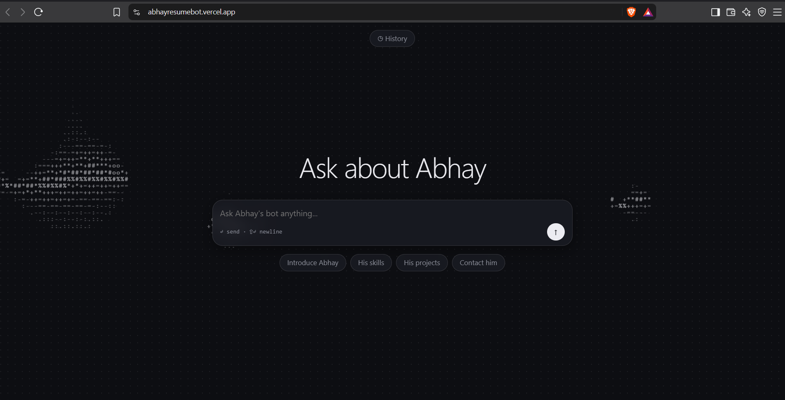

# Abhay's Resume Bot

An AI chatbot that answers recruiters' questions about me using only my resume. Answers stream in word by word.

**Live demo:** https://abhayresumebot.vercel.app


> Hosted on a free tier, so the first question after a quiet period can take up to a minute while the server wakes up.

## Features

- Streaming answers, with conversation memory for follow-up questions
- Saved chat history in the browser
- Answers grounded in my resume; the bot says so when it doesn't know

## How it works

The resume PDF is parsed once by an LLM into validated JSON (cached in `backend/resume.json`). That data goes into the system prompt, and the FastAPI `/chat` route streams the Groq model's reply to a plain HTML/JS frontend.

## Tech stack

Python, FastAPI, Pydantic, Groq API, pypdf, vanilla JavaScript. Hosted on Render (backend) and Vercel (frontend).

## Run locally

```bash
cd backend
pip install -r requirements.txt
echo GROQ_API_KEY=your_key > .env       # put your resume at backend/resume.pdf
uvicorn main:app --reload
```

In another terminal:

```bash
cd frontend
python -m http.server 5500
```

Set `API_URL` in `frontend/script.js` to `http://127.0.0.1:8000`, then open http://127.0.0.1:5500.

## Deployment

Render web service (root `backend`, start `uvicorn main:app --host 0.0.0.0 --port $PORT`) with env vars `GROQ_API_KEY` and `ALLOWED_ORIGINS`; Vercel static site (root `frontend`).

## Author

**Abhay Tiwary** · [LinkedIn](https://www.linkedin.com/in/-abhay-tiwary-)